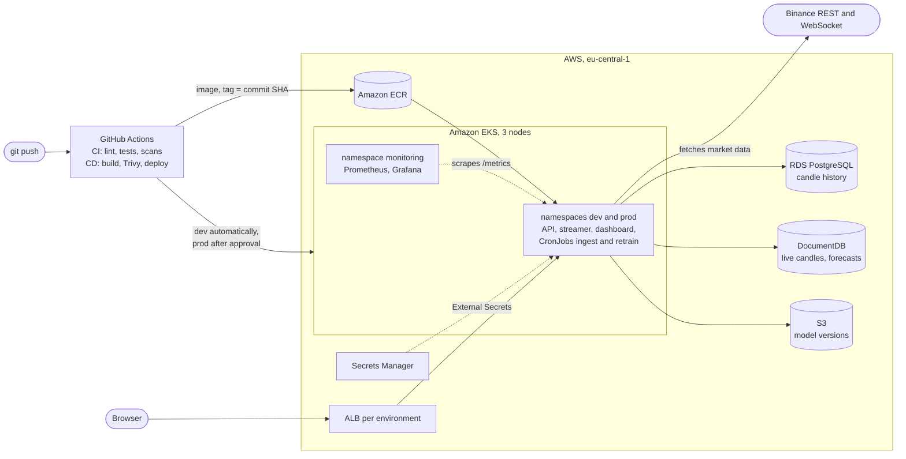

# CryptoBot — Real-Time & Batch Data Pipeline for Crypto Market Data

An end-to-end data engineering platform that ingests Binance BTC/USDT market data through **two independent pipelines** — a batch pipeline for historical candles and a real-time streaming pipeline for live ticks — stores each in a fit-for-purpose database, trains an ML model to forecast the next candle, and serves everything through a REST API and a live Streamlit dashboard. The full stack is containerized and covered by CI. Version 2 runs it in production on Amazon EKS with managed databases, built by Terraform and delivered by GitHub Actions (below).

> Built solo as the capstone Data Engineering project for the DataScientest / Liora Data Engineer programme — designed, implemented, and delivered end-to-end.

## v2: production on AWS

Version 2 runs the platform the way a production system runs: on **Amazon EKS** with **Amazon RDS for PostgreSQL** and **Amazon DocumentDB**, the infrastructure built by **Terraform**, and delivery automated by **GitHub Actions**: every push to `dev` is tested, scanned and deployed to the `dev` namespace; a merge into `main` deploys the same image to `prod` after approval. Prometheus and Grafana monitor both environments and raise an alert when a scheduled job fails. The whole path was proven on AWS on 15 Nov 2026: the platform and both environments built from scratch, prod restored from its snapshots with no data lost, both environments deployed by CD, the alert fired and cleared, a node and a container killed without downtime in prod, prod rolled back and forward, then everything torn down again. The AWS environments exist only during work sessions: Terraform creates and destroys them to keep the cost low.

More detail: [architecture](docs/architecture.md) (four diagrams) · [disaster recovery](docs/disaster-recovery.md) · [monitoring](monitoring/README.md). The finished Data Engineering version (v1) is release [v1.0-data-engineering](https://github.com/patel-pa/CryptoBot/releases/tag/v1.0-data-engineering).

---

## Architecture

Two pipelines that converge at a single serving layer (FastAPI + Streamlit): a batch pipeline (Binance REST → PostgreSQL, every 15 minutes) and a streaming pipeline (Binance WebSocket → MongoDB, every closed 1-minute candle, followed by a forecast). Daily, a job retrains the model on the history and stores it in S3. On AWS:



Each environment has its own databases, secrets and model; the four detailed views (application components, CI/CD pipeline, AWS infrastructure, Kubernetes objects) are in [docs/architecture.md](docs/architecture.md). Locally, `docker compose` runs the same services with PostgreSQL and MongoDB containers.

**Why two databases?** The two sources are fundamentally different, so they get different storage:

| | REST API (historical) | WebSocket (live) |
|---|---|---|
| Shape | Fixed 12-field candles, stable schema | High-frequency, semi-structured messages |
| Cadence | Batch (every 15 minutes) | ~1 message every 2 seconds per symbol (1-minute candles), pushed |
| Store | **PostgreSQL** — schema enforcement, `NUMERIC(18,8)` exact prices, ordered time-series queries | **MongoDB** — high write throughput, flexible JSON, no migrations |
| On AWS | Amazon RDS for PostgreSQL | Amazon DocumentDB (MongoDB-compatible, TLS) |

---

## Tech stack

**Languages & core:** Python 3.11
**Ingestion:** Binance REST API, Binance WebSocket (`websocket-client`, `websockets`)
**Storage:** PostgreSQL (SQLAlchemy 2, psycopg2) on Amazon RDS, MongoDB API (PyMongo) on Amazon DocumentDB; the model in Amazon S3 (versioned)
**Serving:** FastAPI + Uvicorn
**Dashboard:** Streamlit + Plotly
**ML:** scikit-learn, pandas, joblib
**Scheduling:** two commands, `python -m src.cli ingest` and `retrain`, run as Kubernetes CronJobs; v1.0 used Apache Airflow
**Platform:** Amazon EKS (Kubernetes 1.37, 3 × t3.medium), Kustomize (base + dev / prod / local overlays), Helm for the add-ons (AWS Load Balancer Controller, External Secrets Operator, kube-prometheus-stack), EKS Pod Identity, AWS Secrets Manager; kind for local Kubernetes
**Monitoring:** Prometheus, Grafana (dashboards and alert as code), CloudWatch Logs (Fluent Bit)
**Infra & CI/CD:** Docker, Docker Compose, Terraform on AWS, GitHub Actions (CI: ruff + pytest, image build + Trivy scan, Kubernetes manifest validation, Terraform tests, workflow linting; CD: tests, Trivy scan, push to Amazon ECR via OIDC, deploy to the dev namespace on EKS; merges into `main` go to the prod namespace after approval, with the same image by digest; manual deploy or rollback by SHA)
**Testing and security tools:** pytest, Terraform mock-provider tests, kubeconform, Trivy, Dependabot, actionlint, zizmor

---

## Key engineering features

- **Idempotent ingestion** — the batch pipeline uses `ON CONFLICT (symbol, open_time) DO NOTHING`; the stream pipeline uses a unique index on `(symbol, kline_start_time)` + upsert. Re-runs and overlapping ranges never create duplicates.
- **Incremental / resumable loading** — before fetching, the collector reads `MAX(close_time)` from PostgreSQL and resumes 1 ms after the last stored candle, so the same script serves both the initial backfill and scheduled top-ups.
- **Pagination** — handles Binance's 1,000-candle-per-request limit by advancing `startTime` until a partial page signals the present has been reached.
- **Scheduled jobs** — two commands keep the system current: `python -m src.cli ingest` re-runs the idempotent collector, and `python -m src.cli retrain` catches the data up and retrains the model. On Kubernetes they run as CronJobs, every 15 minutes and daily (proven on EKS); in docker compose, `historical` runs `ingest` on every `up` and `retrain` is run by hand. The API picks up a newer model by itself (S3 on AWS, a local file in docker compose), no restart needed. Each command's exit code tells the scheduler whether it failed.
- **Verified data quality** — no gaps, checked twice: in v1, notebook 03 counted **288,238** one-minute BTC/USDT candles (1 Jan–20 Jul 2026) with **0 missing and 0 gaps** (every `open_time` one minute after the previous one, expected count = actual count); in v2 prod (history since 1 Oct 2026), the restore test on 15 Nov 2026 counted **65,760** candles and **0 missing minutes** ([disaster recovery](docs/disaster-recovery.md)).
- **Predicted-vs-actual tracking** — every `/predict` call is persisted, so `/predictions` can join each forecast against the candle's real close for later evaluation.
- **CI on every push** (every branch except `main`) — GitHub Actions runs every check that needs no AWS: ruff and the pytest suite, the image build and its Trivy scan (the same steps CD runs, so on `dev` only CD runs them), the three Kustomize overlays and `monitoring/` rendered and validated against the Kubernetes 1.37 API (kubeconform, strict), a Trivy misconfiguration scan of the Terraform code and the dev/prod manifests (fails on CRITICAL; the accepted findings are listed with their reasons in `.trivyignore.yaml`), and actionlint + zizmor on the workflows. Each Terraform folder gets `fmt -check`, `validate` and its mock-provider tests.
- **CD on every push to `dev`** — the image is tested (ruff + pytest), scanned with Trivy (any CRITICAL vulnerability stops it) and pushed to Amazon ECR under the commit SHA, then deployed to the `dev` namespace on EKS (skipped while no cluster runs); started by hand, it deploys or rolls back to any image already in ECR without rebuilding. A merge into `main` waits for approval, checks that `main` holds exactly the tested dev commit's files, and deploys that commit's image by digest to the `prod` namespace. GitHub signs in to AWS with short-lived OIDC credentials, no stored keys.

---

## Repository structure

```
src/
├── cli.py          # scheduled jobs: python -m src.cli ingest | retrain
├── config.py       # every setting from environment variables
├── collection/     # fetch_historical.py (REST→PG), stream_live.py (WS→Mongo)
├── storage/        # postgres.py, mongo.py, schema.sql, init_db.py, *_writer.py
├── features/       # build_features.py
├── models/         # train_model.py, predict_model.py, model_store.py (the model in S3 or a local file)
├── api/            # main.py (FastAPI: /charts, /stream, /predict, /predictions, /health, /ready, /metrics), metrics.py
├── visualization/  # app.py (Streamlit dashboard: historical + live + predictions)
├── params/         # constants, enums
└── utils/          # retry, time, url and dataframe helpers
k8s/                # Kubernetes manifests (Kustomize): base/ + overlays/local (kind), overlays/dev and overlays/prod (EKS)
monitoring/         # Prometheus + Grafana (Helm chart kube-prometheus-stack): chart settings, Grafana dashboards (JSON), the failed-job alert
infra/terraform/    # AWS infrastructure: bootstrap/ (created once, kept), platform/, envs/dev/ and envs/prod/ (destroyed after every session; prod leaves a final snapshot and is restored from it); modules/environment/ = the databases, secrets and roles of one environment, shared by envs/dev and envs/prod
docs/               # architecture.md (four diagrams), disaster-recovery.md
tests/              # pytest suite
notebooks/          # 01-02 explore the Binance APIs, 03-05 check the local databases (need docker compose up); to re-run: Python 3.11, pip install -r requirements-docker.txt ipykernel, open them from notebooks/
.github/            # actions/test-build-scan: tests, image, Trivy scan (used by CI and CD); workflows/: CI (ci.yml, terraform.yml), CD (cd.yml): every push to dev → tests, image, Trivy scan, push to ECR, deploy to dev; every merge of dev into main → approval → the same image to prod (by digest); deploys skip while no cluster runs; by hand: deploy or roll back; rulesets/: what GitHub refuses on main, dev and the v1 tag
docker-compose.yml  # full stack: postgres, mongodb, init, historical, streamer, api, dashboard
```

---

## Getting started

**Prerequisites:** Docker with the Compose plugin (`docker compose`).

### 1. Configure environment

Copy the template and set your own passwords (`.env.example` lists every variable):

```bash
cp .env.example .env
```

### 2. Launch the full stack

```bash
docker compose up --build
```

That single command brings up everything and wires the pipelines together automatically:

| Service | Role | URL |
|---|---|---|
| `postgres` / `mongodb` | Databases | — |
| `init` | One-shot: create the Postgres table + Mongo indexes, then exit | — |
| `historical` | One-shot: backfill / catch up historical candles (idempotent), then exit | — |
| `streamer` | Always-on: live Binance WebSocket → MongoDB | — |
| `api` | Always-on: FastAPI | http://localhost:8000/docs |
| `dashboard` | Always-on: Streamlit live chart + predictions | http://localhost:8501 |

Because `historical` runs idempotently in the background, the dashboard is usable while the database catches up. There is no scheduler in docker compose: train the model once (and whenever you want a fresh one) with `retrain` below. To run a step manually:

```bash
docker compose run --rm api python -m src.storage.init_db          # schema + indexes
docker compose run --rm api python -m src.cli ingest               # backfill / catch up
docker compose run --rm api python -m src.cli retrain              # catch up, then train the model
```

---

## Run on Kubernetes locally (kind)

The same image and manifests as on AWS, in a local test cluster: `k8s/overlays/local` adds in-cluster Postgres and MongoDB and keeps the model on a local disk instead of S3. Needs Docker, [kind](https://kind.sigs.k8s.io/) and kubectl.

```bash
kind create cluster --name cryptobot
docker build --target runtime -t cryptobot-app:local .
kind load docker-image cryptobot-app:local --name cryptobot

cp k8s/overlays/local/postgres.env.example k8s/overlays/local/postgres.env   # then set passwords
cp k8s/overlays/local/mongo.env.example    k8s/overlays/local/mongo.env
kubectl apply -k k8s/overlays/local

kubectl -n cryptobot get pods                                   # wait until Running / Completed
kubectl -n cryptobot create job --from=cronjob/ingest  ingest-now     # don't wait for the schedule
kubectl -n cryptobot create job --from=cronjob/retrain retrain-now
kubectl -n cryptobot port-forward svc/dashboard 8501:8501       # http://localhost:8501

kind delete cluster --name cryptobot                            # removes the cluster and its data
```

The `ingest` (every 15 min) and `retrain` (daily) CronJobs also run on their own. After a code change: build and `kind load` again, then `kubectl -n cryptobot rollout restart deployment`. Monitoring (Prometheus, Grafana dashboards, the failed-job alert) installs on the same cluster with Helm: see [monitoring/README.md](monitoring/README.md).

- **Set the passwords before the first apply.** Postgres and MongoDB take them only when their data disk is empty; to change them later, `kind delete cluster --name cryptobot` and start again.
- **Applying again within 10 minutes** (while the finished `init-db` Job still exists) fails with `field is immutable` if anything it uses changed. Delete it first: `kubectl -n cryptobot delete job init-db --ignore-not-found`.

---

## Deploy to dev on EKS

The same manifests in the `dev` namespace of the EKS cluster: `k8s/overlays/dev` adds the database connection details from AWS Secrets Manager (External Secrets), TLS to RDS and DocumentDB, the model in S3, and the dashboard behind an ALB. Needs the Terraform layers [`platform`](infra/terraform/platform/README.md) and then [`envs/dev`](infra/terraform/envs/dev/README.md) applied (pods get their AWS rights only if `envs/dev` exists when they start), the app image in ECR (the CD workflow pushes it after a successful run on `dev`, tagged with the full commit SHA), and kubectl within one minor version of the cluster (1.36–1.38). Once per AWS account, before all of this: apply the [`bootstrap`](infra/terraform/bootstrap/README.md) layer (state bucket, GitHub roles, ECR, model bucket) and set the repository secret `AWS_ACCOUNT_ID` (its README).

### With CD (the normal way)

Every push to `dev` runs `.github/workflows/cd.yml`: after the image job (tests, build, Trivy scan, push to ECR) the deploy job signs in as `cryptobot-github-deploy-dev` (may change only the `dev` namespace) and deploys that commit, then waits until `init-db` has finished and the API, streamer and dashboard run. **Without a running cluster** (between work sessions) it skips with a notice and stays green; a cluster without `envs/dev` (no SecretStore) makes it fail.

Started by hand, the workflow only deploys: no build, no new scan. The image must already be in ECR, i.e. that commit's CD run passed (ECR keeps the newest 30 images). Start it only when no CD run is waiting: GitHub keeps one waiting run per branch and cancels an older one.

```bash
gh run list --workflow cd.yml --limit 3                    # every line ✓, X or - (none with *)?
gh workflow run cd.yml --ref dev                           # deploys the newest commit on dev, e.g. after a session's applies
gh run list --workflow cd.yml --limit 1                    # its run ID; follow it with: gh run watch <run ID>

# Rollback: the newest images in ECR (tag = full commit SHA), then deploy one of them
aws ecr describe-images --region eu-central-1 --repository-name cryptobot --query "reverse(sort_by(imageDetails[?imageTags],&imagePushedAt))[:5].[imagePushedAt,join(',',imageTags)]" --output text
gh workflow run cd.yml --ref dev -f image_sha=<full SHA from that list>
```

Or use the "Run workflow" button in GitHub's Actions tab (it needs `cd.yml` on the default branch `main`): pick the branch; `image_sha` is optional.

A **rollback** deploys the old commit as a whole: its manifests together with its image, the pair that was tested together. Objects that only newer commits have (e.g. a new CronJob) stay, because `kubectl apply` deletes nothing. It does not run the tests or Trivy again, so a vulnerability published since then cannot block it.

After the first deploy of a session (dev starts empty), from your laptop:

```bash
aws eks update-kubeconfig --name cryptobot --region eu-central-1   # = terraform output -raw kubeconfig_command
kubectl -n dev create job --from=cronjob/retrain retrain-now       # loads the last day, trains, uploads the model
kubectl -n dev get ingress dashboard -o jsonpath='{.status.loadBalancer.ingress[0].hostname}'   # open http://<that name> (DNS: 1-3 min)
```

### By hand (fallback)

```bash
aws eks update-kubeconfig --name cryptobot --region eu-central-1   # = terraform output -raw kubeconfig_command

# The image address contains the AWS account ID, so it goes into a file Git ignores (k8s/deploy/):
REGISTRY=$(aws ecr describe-repositories --region eu-central-1 --repository-names cryptobot \
  --query "repositories[0].repositoryUri" --output text)
TAG=$(git rev-parse origin/dev)          # the newest pushed commit; its CD run must be green:
aws ecr describe-images --region eu-central-1 --repository-name cryptobot \
  --image-ids imageTag="$TAG" --query "imageDetails[0].imagePushedAt"   # an error = no image yet
mkdir -p k8s/deploy/dev
cat > k8s/deploy/dev/kustomization.yaml <<EOF
apiVersion: kustomize.config.k8s.io/v1beta1
kind: Kustomization
resources:
  - ../../overlays/dev
images:
  - name: cryptobot-app
    newName: ${REGISTRY}
    newTag: ${TAG}
EOF

kubectl -n dev delete job init-db --ignore-not-found          # a finished Job can only be replaced
kubectl apply -k k8s/deploy/dev
kubectl -n dev get externalsecrets                            # STATUS SecretSynced, READY True
kubectl -n dev get pods                                       # wait until Running / Completed
kubectl -n dev create job --from=cronjob/retrain retrain-now  # loads the last day, trains, uploads the model
kubectl -n dev get ingress dashboard \
  -o jsonpath='{.status.loadBalancer.ingress[0].hostname}'    # open http://<that name> (DNS: 1-3 min)
```

Until the first `retrain` has uploaded a model, `POST /predict` answers 503 and the API logs `AccessDenied` for `dev/model.pkl` (S3 says so for a missing file when the role may not list the bucket).

**Before destroying the infrastructure, remove the app.** Its Ingress owns an ALB that Terraform did not create; it keeps costing money and blocks deleting the VPC. First make sure no CD run can deploy it again: no push to `dev` from now until `envs/dev` is destroyed, and no CD run waiting or running.

```bash
gh run list --workflow cd.yml --limit 3                       # every line ✓, X or - (none with *)
kubectl delete -k k8s/overlays/dev --ignore-not-found         # the Load Balancer Controller deletes the ALB
aws elbv2 describe-load-balancers --region eu-central-1 \
  --query "LoadBalancers[].LoadBalancerName"                  # repeat until no cryptobot-dev
```

Then destroy [`envs/dev`](infra/terraform/envs/dev/README.md), and [`platform`](infra/terraform/platform/README.md) once `envs/dev` and `envs/prod` (whichever ran) are destroyed.

## Deploy to prod on EKS

The same app in the `prod` namespace of the same cluster: `k8s/overlays/prod` is the dev overlay with prod's values (secrets `cryptobot/prod/*`, model `prod/model.pkl`, its own ALB `cryptobot-prod`, two API pods, the history since 1 Oct 2026). Needs the Terraform layers `platform` and then [`envs/prod`](infra/terraform/envs/prod/README.md) applied (its README: the very first create, the restore from the newest final snapshot, the teardown in two steps). **After a restore, plan and apply `envs/prod` once more before deploying:** that second apply gives the restored DocumentDB its new password (a restored DocumentDB keeps the snapshot's old one; the plan shows exactly one change). Prod is deployed only from `main`, after your approval, with the image that was built, tested and scanned on `dev`: nothing is built for prod.

### Once, before the first merge: the GitHub environment `production`

A workflow that names an environment that does not exist yet makes GitHub create it **without any protection**, so set it up first (repository Settings → Environments → New environment → `production`):

- **Required reviewers:** you. Leave "Prevent self-review" off: you approve your own merges.
- **Deployment branches and tags:** "Selected branches and tags" → add the branch `main`. This is the lock that matters: the AWS role `cryptobot-github-deploy-prod` trusts every job in this environment (bootstrap README).

### Rulesets on `main`, `dev` and the v1 tag

Three rulesets (Settings → Rules → Rulesets), kept as files in `.github/rulesets/` and created from them with `gh api` (below). Nobody may bypass them, the repository owner included.

| File | Applies to | GitHub refuses |
|---|---|---|
| `main.json` | branch `main` | any change that is not a merged pull request; a squash or rebase merge (prod deploys only merge commits); a merge before the checks `Render, validate, scan the configuration`, `Lint the workflows` (CI), `Test, build, scan, push` (CD) and `Terraform checks passed` are green on the pull request's newest commit, reported by GitHub Actions; a force push; deleting the branch |
| `dev.json` | branch `dev` | a force push; deleting the branch (direct pushes stay allowed) |
| `v1-tag.json` | tag `v1.0-data-engineering` | moving or deleting the tag |

A merge needs no approval (GitHub never lets the author approve their own pull request): the human check is the approval in `production`. The pull request need not be up to date with `main` (`dev` never contains main's merge commits): the prod job checks that the merged files are exactly the tested ones.

```bash
gh api --method POST repos/{owner}/{repo}/rulesets --input .github/rulesets/main.json
gh api --method POST repos/{owner}/{repo}/rulesets --input .github/rulesets/dev.json
gh api --method POST repos/{owner}/{repo}/rulesets --input .github/rulesets/v1-tag.json
# After editing a file: its id from `gh api repos/{owner}/{repo}/rulesets`, then
gh api --method PUT repos/{owner}/{repo}/rulesets/<id> --input .github/rulesets/main.json
```

### With CD (the normal way)

1. Open a pull request from `dev` to `main`. GitHub lets you merge it only once the four required checks of that dev commit are green (CD's among them: only the run of a push to dev reports it, after building, testing and scanning the image, so its image is in ECR), and only with **"Create a merge commit"**: the merge's second parent is the tested dev commit, which is how the job finds its image.
2. The push to `main` starts `cd.yml`; its job "Deploy to prod" waits for you: Actions → that run → **Review deployments** → `production` → **Approve and deploy**.
3. The job then checks that the commit is a merge on `main` whose files are exactly those of the merged dev commit (a change made directly on `main`, or inside the merge, was never tested: the job stops), finds that dev commit's image in ECR, gives it the second tag `prod-<main SHA>` (ECR keeps the newest 10 of those whatever dev does), and deploys it to `prod` **by digest**. Without a running cluster it tags the image and skips the deploy (green); a cluster without `envs/prod` makes it fail.

```bash
gh pr create --base main --head dev --title "Release: <what changed>" --body "<summary>"
gh pr merge <PR number> --merge                              # a merge commit, never --squash or --rebase
gh run list --workflow cd.yml --branch main --limit 1        # then approve it in the Actions tab

# After a session's applies, deploy the newest main commit (again with approval):
gh workflow run cd.yml --ref main

# Rollback: an older merge on main, deployed with its own manifests and image (again with approval)
git fetch origin && git log --first-parent --merges --format="%H %cs %s" origin/main -5
gh workflow run cd.yml --ref main -f image_sha=<full SHA of an older merge from that list>
```

After the very first deploy (prod starts empty; after a restore the model and the history are already there):

```bash
aws eks update-kubeconfig --name cryptobot --region eu-central-1   # kubectl to the EKS cluster (not kind)
kubectl -n prod create job --from=cronjob/retrain retrain-now      # loads the history since 1 Oct 2026, trains, uploads prod/model.pkl
kubectl -n prod get ingress dashboard -o jsonpath='{.status.loadBalancer.ingress[0].hostname}'   # open http://<that name>
```

**Before destroying prod, remove the app**, as for dev: no merge to `main` and no CD run on `main` until `envs/prod` is destroyed.

```bash
gh run list --workflow cd.yml --branch main --limit 3         # every line ✓, X or - (none with *: also waiting for approval)
kubectl delete -k k8s/overlays/prod --ignore-not-found        # the Load Balancer Controller deletes the ALB
aws elbv2 describe-load-balancers --region eu-central-1 \
  --query "LoadBalancers[].LoadBalancerName"                  # repeat until no cryptobot-prod
```

Then destroy `envs/prod` in its two steps (its README). Its **final snapshots stay on purpose** (a few cents per month): the next create restores them. Then `platform`, once `envs/dev` and `envs/prod` (whichever ran) are destroyed.

---

## Dev and prod: what differs

Both environments run the same image and the same base manifests (`k8s/base`); only these values differ.

| Setting | dev | prod | Where |
|---|---|---|---|
| Kubernetes namespace | `dev` | `prod` | `k8s/overlays/<env>/kustomization.yaml` |
| API pods | 1 | 2, spread over the nodes, PodDisruptionBudget (at least 1) | `k8s/overlays/prod/` |
| History on an empty database | the last day (`HISTORICAL_LOOKBACK_DAYS=1`) | since 1 Oct 2026 (`HISTORICAL_START_DATE`) | overlay ConfigMap |
| Secrets in Secrets Manager | `cryptobot/dev/*` | `cryptobot/prod/*` (dev's SecretStore can never read them) | `external-secrets.yaml`, `infra/terraform/envs/<env>` |
| Model in S3 | `dev/model.pkl` | `prod/model.pkl` | overlay ConfigMap, pod roles |
| Load balancer | ALB `cryptobot-dev` | ALB `cryptobot-prod` | `ingress.yaml` |
| PostgreSQL (RDS) | `db.t4g.micro` | `db.t4g.small` | `infra/terraform/envs/<env>/main.tf` |
| DocumentDB | `db.t4g.medium` (the smallest offered) | `db.t4g.medium` | same |
| Automated backups | 1 day | 7 days | same |
| Deletion protection | off | on | same |
| When the environment is destroyed | deleted; starts empty next time and reloads the last day | final snapshot of both databases; restored on the next create | `infra/terraform/modules/environment` |
| Deployed by | every push to `dev` | a merge into `main`, after approval (GitHub environment `production`) | `.github/workflows/cd.yml` |
| Image | built, tested and scanned on `dev` | the same image, by digest | same |

---

## Monitoring

kube-prometheus-stack (Helm) runs in the namespace `monitoring`: **Prometheus** scrapes the API's `/metrics` in `dev` and `prod` and the cluster (kube-state-metrics, node-exporter) every 30 s; **Grafana** shows two dashboards, *CryptoBot / API* (traffic, server errors, response times, forecasts stored, memory and CPU) and *CryptoBot / Scheduled jobs and pods* (latest run of each CronJob, time since the last success, failed Jobs, pods not ready, restarts), and evaluates the alert **Scheduled job failed** (the newest failed run of a CronJob started after its newest successful run). Dashboards and the alert rule are files in `monitoring/`: Grafana loads them at every start, so nothing is configured by hand and nothing needs a disk. The platform layer installs it on EKS; container logs go to CloudWatch Logs (7 days). Setup, the alert test and how to change a dashboard: [monitoring/README.md](monitoring/README.md).

---

## Security

| Layer | What protects it |
|---|---|
| Code and dependencies | Pinned: the app's direct Python dependencies, the base image (by digest), the actions (by commit SHA) and the tools CI adds (by image digest or checksum; the runner's own AWS CLI and jq excepted). Dependabot opens weekly update pull requests into `dev`; Dependabot alerts report known vulnerabilities. GitHub secret scanning with push protection blocks pushes that contain keys. No password defaults in code, and passwords never appear in logs (`repr=False`). |
| CI/CD | Every image is scanned by Trivy before it may reach ECR (any CRITICAL vulnerability stops it; fixable HIGH ones are listed in the log). Trivy also scans the Terraform code and the dev and prod manifests for misconfigurations: the accepted findings are listed with their reasons in `.trivyignore.yaml`, any other CRITICAL one fails CI. actionlint and zizmor check the workflows. GitHub signs in to AWS with OIDC (no stored keys), one role per job, and the AWS account ID exists only as a repository secret. Prod deploys need approval in the GitHub environment `production`. Rulesets that nobody may bypass (`.github/rulesets/`): `main` changes only through a pull request whose four required checks are green, merged as a merge commit; no force push or deletion on `main` and `dev`; the tag `v1.0-data-engineering` can't be moved or deleted. |
| Container image | Slim Debian base, pinned by digest; no setuptools or wheel at runtime; the AWS database CA bundle pinned by checksum. The app runs as the non-root user `10001` and cannot change its own code. |
| Kubernetes | Every app pod: `runAsNonRoot`, read-only root file system, no privilege escalation, all Linux capabilities dropped, the default seccomp profile, no service account token (the app never calls the Kubernetes API). The `dev` and `prod` namespaces enforce the Pod Security Standard `restricted`, so no deploy can start a privileged or host-level pod on the shared nodes. The CI deploy roles may change only their own namespace and cannot create or change SecretStores (`infra/terraform/platform/README.md`, "Who may do what in the cluster"). |
| AWS | One IAM role per ServiceAccount through EKS Pod Identity (API reads the model, retrain writes it, External Secrets reads its own environment's secrets: dev can never read prod's). Databases in private subnets, reachable only from the nodes, with TLS. Passwords are generated by Terraform and written straight to Secrets Manager, never into the Terraform state. |

---

## Disaster recovery

Pods hold no state: the data lives in RDS, DocumentDB and S3, so pods, nodes and the whole cluster can be replaced at any time.

- **Container or node fails:** liveness probes restart a hung API or dashboard container, Deployments replace lost pods, prod runs two API pods spread over the nodes, and the managed node group replaces a lost node. Tested on 15 Nov 2026: a terminated node and a deleted API pod caused no downtime of the prod dashboard.
- **Backups:** automated database backups while a session runs (dev 1 day, prod 7 days), a final snapshot of both prod databases at every teardown (what carries prod's data between sessions), the model and the Terraform state in versioned S3 buckets, the newest 30 images (and the newest 10 prod releases) in ECR, each under its commit SHA.
- **Rebuild from IaC:** `platform` → `envs/dev` and `envs/prod` (prod restores its newest snapshots) → deploy with CD; about an hour, done at the start of every work session.
- **Roll back:** a manual CD run with an older commit SHA deploys that commit's manifests and image again (prod after approval); about a minute.

Steps, times and test results: [docs/disaster-recovery.md](docs/disaster-recovery.md).

---

## API endpoints

| Endpoint | Type | Source | Purpose |
|---|---|---|---|
| `/health` | GET | — | Liveness: the API process is up (no database calls) |
| `/ready` | GET | PostgreSQL + MongoDB | Readiness: 200 if both databases answer, else 503 |
| `/charts` | GET | PostgreSQL | Historical OHLCV for charting (`limit` 1–1000, default 100) |
| `/predict` | POST | MongoDB + model | Forecasts the next candle's close and stores it; the streamer calls it after each closed candle |
| `/predictions` | GET | MongoDB | Stored forecasts joined with actual closes (predicted-vs-actual; `limit` 1–1440, default 240) |
| `/stream` | WebSocket | Binance (live) | Real-time tick feed relayed to the browser |
| `/metrics` | GET | — | Prometheus metrics: requests and durations per route and status, plus Python/process stats (for monitoring, not listed in `/docs`) |

All times are UTC (ISO 8601, without an offset). Interactive docs: http://localhost:8000/docs

---

## Testing

Lint and tests run in the Dockerfile's `test` stage (the production packages plus ruff and pytest), so the result is the same on every machine:

```bash
docker build --target test -t cryptobot-test .
docker run --rm --network none cryptobot-test        # ruff check . + pytest (they need no network)
```

Without Docker (Python 3.11): `pip install -r requirements-docker.txt -r requirements-dev.txt`, then `ruff check .` and `pytest`.

CI runs exactly these two commands, then builds the runtime image and scans it with Trivy (`.github/actions/test-build-scan`, used by `.github/workflows/ci.yml` and `cd.yml`).
