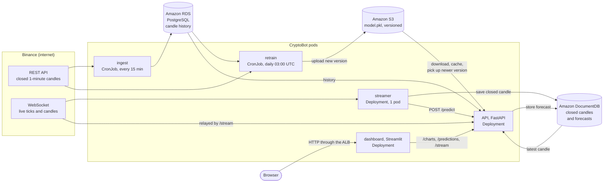
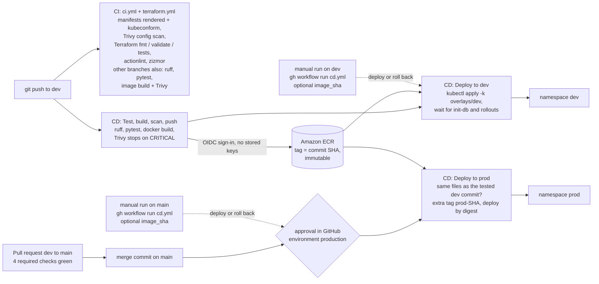
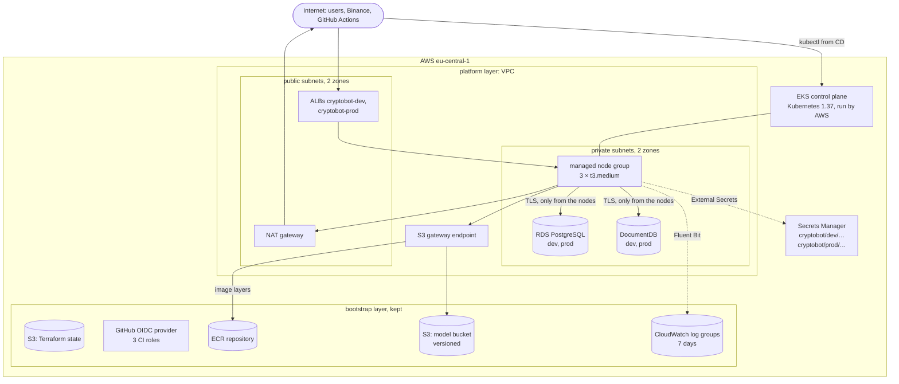
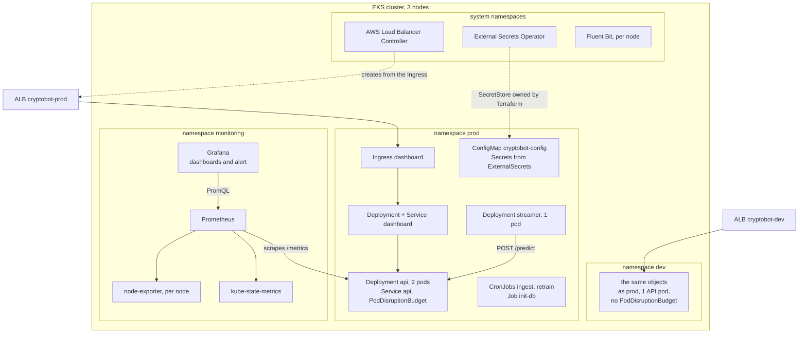

# Architecture

CryptoBot v2 runs on **Amazon EKS** in `eu-central-1` (Frankfurt; Binance refuses US addresses).
Two environments, `dev` and `prod`, share one cluster as two Kubernetes namespaces; each has its
own Amazon RDS for PostgreSQL and Amazon DocumentDB. Terraform builds the AWS infrastructure (the
load balancers come from the Load Balancer Controller that Terraform installs), and GitHub Actions
builds, tests, scans and deploys the one application image.

Four views, from the inside out:

1. [Application components](#1-application-components): what the program does with the data
2. [CI/CD pipeline](#2-cicd-pipeline): how a change gets from `git push` to dev and prod
3. [AWS infrastructure](#3-aws-infrastructure): the network, the cluster, the databases, the Terraform layers
4. [Kubernetes architecture](#4-kubernetes-architecture): the objects inside the cluster

---

## 1. Application components

One candle's journey: a 1-minute candle closes on Binance → the **streamer** receives it over the
WebSocket and saves it in **DocumentDB** → it calls **`POST /predict`** → the **API** predicts the next
close with the model it cached from **S3** and stores the forecast in DocumentDB → the **dashboard**
shows history (PostgreSQL), the live price, the forecast and forecast-vs-actual. Every 15 minutes
**ingest** tops up PostgreSQL from the REST API; once a day **retrain** does the same, trains a new
model on the history and uploads it as a new S3 version, which the API loads by itself.

| Process | Kubernetes object | Reads | Writes |
|---|---|---|---|
| `python -m src.cli ingest` | CronJob `ingest` (`*/15 * * * *`) | Binance REST | PostgreSQL (insert, existing rows skipped; only closed candles) |
| `python -m src.cli retrain` | CronJob `retrain` (`0 3 * * *`) | Binance REST, PostgreSQL | PostgreSQL, S3 `<env>/model.pkl` |
| `python -m src.collection.stream_live` | Deployment `streamer` (exactly 1 pod) | Binance WebSocket | DocumentDB; calls `POST /predict` |
| `uvicorn src.api.main:app` | Deployment `api` (dev 1, prod 2 pods) | PostgreSQL, DocumentDB, S3, Binance WebSocket (relayed by `/stream`) | DocumentDB (forecasts) |
| Streamlit `src/visualization/app.py` | Deployment `dashboard` | the API only | – |
| `python -m src.storage.init_db` | Job `init-db` (every deploy) | – | tables in PostgreSQL, unique indexes in DocumentDB for candles and forecasts (idempotent) |

Every process is stateless: data lives in the two databases and S3, so pods and even the whole
cluster can be replaced at any time.

---

## 2. CI/CD pipeline

- **Branches:** work happens on `dev`; `main` is the stable branch and changes only through a pull
  request whose four required checks are green, merged as a merge commit (GitHub rulesets, nobody
  may bypass them).
- **Build once, promote the same image:** only a push to `dev` builds an image. Prod gets exactly
  that image, by digest, after the prod job has checked that `main` holds exactly the tested dev
  commit's files. Nothing is rebuilt for prod.
- **Approval gate:** the prod job runs in the GitHub environment `production`, which waits for the
  owner's approval and allows only `main`.
- **No stored cloud keys:** only the three CD jobs touch AWS (CI and the Terraform checks never do);
  each signs in with short-lived OIDC credentials under its own IAM role, and each deploy role may
  change only its own namespace.
- **Rollback:** a manual run with an older commit SHA deploys that commit's manifests and image
  again (prod: an older merge on `main`, again with approval). See
  [disaster-recovery.md](disaster-recovery.md#4-roll-back-to-a-previous-version).

---

## 3. AWS infrastructure

| Terraform layer | Lifetime | What it creates |
|---|---|---|
| `infra/terraform/bootstrap` | created once, **kept** | state bucket, GitHub OIDC + CI roles, ECR, the versioned model bucket, CloudWatch log groups |
| `infra/terraform/platform` | created and **destroyed every work session** | VPC (2 zones, 1 NAT gateway, S3 endpoint), EKS + 3 nodes, add-ons (VPC CNI, CoreDNS, kube-proxy, Pod Identity agent, CloudWatch container logs), AWS Load Balancer Controller, External Secrets, monitoring (kube-prometheus-stack), namespaces, deploy permissions |
| `infra/terraform/envs/dev` | every session | RDS + DocumentDB (smallest, 1-day backups, no deletion protection), 4 secrets, SecretStore, pod roles |
| `infra/terraform/envs/prod` | every session; **final snapshot on destroy, restore on create** | the same with prod values (7-day backups, deletion protection) |

`envs/dev` and `envs/prod` call the same module (`infra/terraform/modules/environment`) with
different values. The databases sit in private subnets; their security groups accept only the
nodes. Passwords are generated by Terraform as write-only values and stored only in Secrets
Manager, never in the Terraform state. The ALBs are not in Terraform: the Load Balancer Controller
creates them from each environment's Ingress, so the teardown deletes the Ingresses first.

---

## 4. Kubernetes architecture

| Object | Settings that matter |
|---|---|
| Deployment `api` | liveness probe `/health` (the process answers; restart if not) and readiness probe `/ready` (both databases answer; no traffic if not); requests and memory limits; prod: 2 pods spread over the nodes, PodDisruptionBudget `minAvailable: 1` |
| Deployment `dashboard` | liveness and readiness probe on Streamlit's `/_stcore/health` |
| Deployment `streamer` | exactly 1 pod, strategy `Recreate` (a second pod would only repeat each candle write and forecast request: wasted work; the upserts keep one copy) |
| CronJobs `ingest`, `retrain` | `concurrencyPolicy: Forbid` (never two runs at once), history 3 successful + 3 failed; a start missed by more than 5 min (`ingest`) or 1 h (`retrain`) is skipped |
| Job `init-db` | applied by every deploy, idempotent; CD waits for it to finish, then for the rollouts |
| ServiceAccounts `api`, `retrain` | EKS Pod Identity: one IAM role each (read the model / write the model); the other app pods (ServiceAccount `cryptobot`) get no AWS rights. The platform's controllers (Load Balancer Controller, External Secrets, the CloudWatch add-on's Fluent Bit) have their own roles (`infra/terraform/platform/controllers.tf`) |
| ExternalSecrets | turn `cryptobot/<env>/*` from Secrets Manager into Kubernetes Secrets through the namespace's SecretStore (created by Terraform; dev's store can never read prod's secrets) |
| Every app pod | runs as a non-root user, read-only root file system, no privilege escalation, all capabilities dropped; the namespaces `dev` and `prod` enforce Pod Security `restricted`, so Kubernetes refuses any pod that may run as root, gain privileges, keep capabilities or reach into the node (the read-only root file system is our own setting, not enforced) |
| Monitoring | kube-prometheus-stack (Helm, installed by Terraform): a ServiceMonitor scrapes the API in `dev` and `prod`; Grafana loads the dashboards and the alert rule from `monitoring/` (details in [monitoring/README.md](../monitoring/README.md)) |
| Logs | Fluent Bit (EKS CloudWatch add-on) sends every container's output to CloudWatch Logs |
| Local copy | `k8s/overlays/local` runs the same base on kind, with PostgreSQL and MongoDB as pods |
